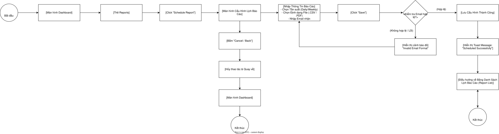
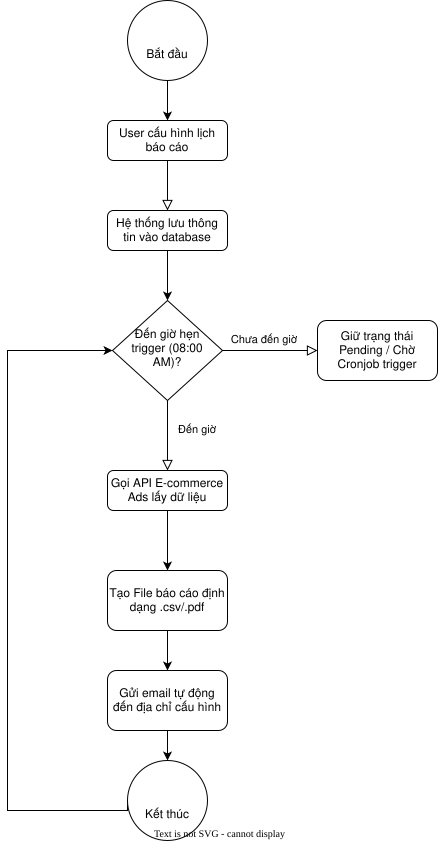

# E-Commerce Advertising Platform - Automated Reporting Feature Spec

> **Domain:** SaaS / AdTech / Retail Media
> **Target Product:** E-Commerce Advertising Platform
> **Role:** IT Business Analyst Intern Candidate
> **Author:** Trần Hương Linh

## 1. Business Context & Problem Statement

- **Business Context:** Nhà bán hàng (Sellers/Brands) vận hành các chiến dịch quảng cáo trên nền tảng Thương mại điện tử cần theo dõi chỉ số hiệu quả định kỳ.
- **Problem:** Việc đăng nhập và xuất báo cáo thủ công mỗi ngày mất thời gian và dễ bỏ sót dữ liệu quan trọng.
- **Solution:** Thiết kế tính năng cho phép đặt lịch gửi báo cáo hiệu quả quảng cáo (Spend, Revenue, ROAS/ACoS) tự động định kỳ qua Email.

## 2. Requirement Documentation (User Story & Acceptance Criteria)

### User Story

> **As an** E-commerce Advertiser,  
> **I want to** schedule automated email reports for my campaign performance,  
> **So that** I can track my ad metrics regularly without manual data exports.

### Acceptance Criteria (AC)

- **AC 1 (Schedule Config):** Cấu hình tần suất gửi `Daily` (08:00 AM hàng ngày) hoặc `Weekly` (Thứ 2 hàng tuần).
- **AC 2 (Report Format):** File đính kèm định dạng `.CSV` hoặc `.PDF` gồm các trường: Campaign Name, Impressions, Clicks, Spend, Revenue, ACoS/ROAS.
- **AC 3 (Recipients):** Cho phép cấu hình tối đa 3 Email nhận báo cáo.
- **AC 4 (Validation):** Báo lỗi dạng text đỏ `"Invalid email format"` nếu nhập sai định dạng Email.

## 3. Flow Diagrams

### User Flow (Mô hình hóa Luồng Thao tác & Xử lý Lỗi Giao diện)

User Flow thể hiện rõ luồng chính (Happy Path), luồng hủy (Cancel Path) và luồng kiểm tra dữ liệu lỗi (Validation Flow) khép kín.

### Business Flow (Mô hình hóa Luồng Nghiệp vụ Hệ thống & Tự động hóa)

Business Flow thể hiện cách dữ liệu luân chuyển ở Backend, cơ chế Cronjob trigger 08:00 AM định kỳ, gọi API E-commerce Ads và tự động gửi Email báo cáo.

