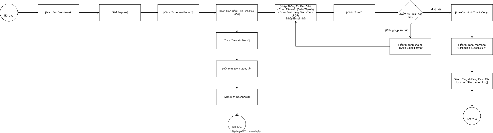
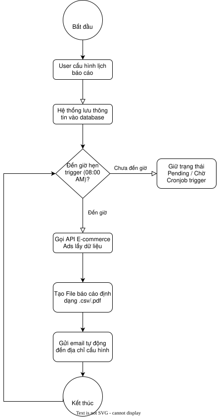

# E-Commerce Advertising Platform - Automated Reporting Feature Spec

> **Domain:** SaaS / AdTech / Retail Media
> **Target Product:** E-Commerce Advertising Platform Practice project (fictional product)
> **Role:** Product Owner
> **Author:** Trần Hương Linh

## 1. Business Context & Problem Statement

- **Business Context:** E-commerce sellers (Sellers/Brands) running advertising campaigns on e-commerce platforms need to monitor performance metrics periodically.
- **Problem:** Logging in and exporting reports manually every day is time-consuming, and important changes in performance can be missed.
- **Why it matters:** Slow reporting delays optimization decisions (budget, bids, campaign pauses), which can directly affect ad spend efficiency.
- **Solution:** A feature that allows scheduling automated, periodic email delivery of ad performance reports (Spend, Revenue, ROAS/ACoS).

## 2. Goals & Success Metrics (proposed)

| Goal | Metric | Target |
|---|---|---|
| Adoption | % of active advertisers who enable scheduled reports within 30 days | To be set after baseline data |
| Engagement | Report email open rate / attachment download rate | To be set after baseline data |
| Efficiency | Number of manual report exports per advertiser | Decrease vs. baseline |
| Support | Tickets related to "how to export a report" | Decrease vs. baseline |

## 3. Scope

**In scope (MVP):** Scheduled email reports (Daily / Weekly), CSV or PDF attachment, up to 3 recipients, email format validation.

**Out of scope (for now):** Custom metric selection, in-app report history, delivery to other channels (e.g., Slack), monthly schedule.

## 4. Prioritization (MoSCoW)

| Priority | Item |
|---|---|
| Must | Schedule configuration, CSV/PDF report with defined fields, recipient email validation |
| Should | Pause or delete a schedule, notification when sending fails |
| Could | Custom send time, additional metrics |
| Won't (now) | Multi-channel delivery, monthly schedule |

## 5. User Story & Acceptance Criteria

### User Story

> **As an** E-commerce Advertiser,
> **I want to** schedule automated email reports for my campaign performance,
> **So that** I can track my ad metrics regularly without manual data exports.

### Acceptance Criteria (AC)

- **AC 1 (Schedule Config):** Configure sending frequency: `Daily` (08:00 AM daily) or `Weekly` (every Monday).
- **AC 2 (Report Format):** Attached file format `.CSV` or `.PDF` including fields: Campaign Name, Impressions, Clicks, Spend, Revenue, ACoS/ROAS.
- **AC 3 (Recipients):** Allow configuring a maximum of 3 recipient emails.
- **AC 4 (Validation):** Display red error text `"Invalid email format"` if an incorrect email format is entered.

## 6. Flow Diagrams

### User Flow (Interaction Flow & UI Error Handling)

Shows the main flow (Happy Path), cancellation flow (Cancel Path), and closed-loop validation flow.

### Business Flow (System Flow & Automation)

Shows how data flows in the backend: the 08:00 AM cronjob trigger, calls to the e-commerce Ads APIs, and automatic report emails.

## 7. Open Questions & Assumptions

- Which time zone applies to the 08:00 AM schedule?
- What should the report show when a campaign has no data for the period?
- How are large reports handled (file size, API rate limits)?
- Should failed sends be retried, and how many times?
